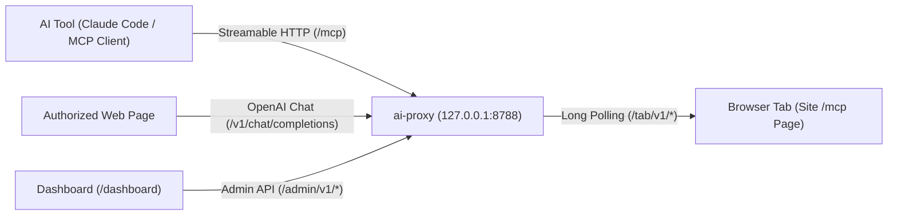

# MCP Pages & ai-proxy Documentation

**MCP Pages** is an open specification that enables any static website (such as GitHub Pages) to expose [WebMCP](https://github.com/webmachinelearning/webmcp) tools directly to a reader's local AI coding assistants—without requiring a backend server.

**`ai-proxy`** is the zero-dependency reference relay running on the reader's machine (`127.0.0.1:8788`). It bridges local AI clients (Claude Code, Cursor, MCP stdio/HTTP clients) to browser tabs running static MCP Pages.

## Architecture Overview



## Quick Start

Start the local relay and register this site's MCP page in your AI tool:

```bash
npx ai-proxy serve
npx ai-proxy add https://<host>/<org>/<repo>/mcp.html
```

Or connect any example static site:

```bash
npx ai-proxy allow https://example.github.io/my-docs/
npx ai-proxy add https://example.github.io/my-docs/mcp.html
```

## Core Specifications

1. **[MCP Pages Specification (`spec.md`)](doc.html?d=spec)** — How static sites normalize URLs, receive per-page keys via URL fragments, register WebMCP tools, and manage tab lifecycles.
2. **[Wire Protocol (`protocol.md`)](doc.html?d=protocol)** — Complete HTTP request, response, status code, and error reference for `/mcp`, `/tab/v1/*`, `/v1/*`, and `/admin/v1/*`.
3. **[Security Model (`security.md`)](doc.html?d=security)** — Multi-tenant origin threat model (`<user>.github.io`) and the seven mandatory security invariants with the attacks each rule prevents.
