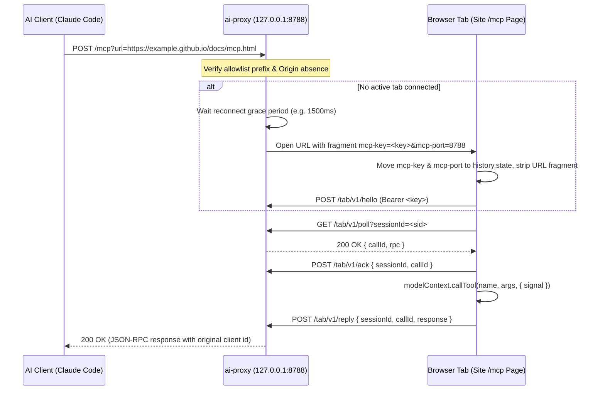

# MCP Pages Specification

**MCP Pages** defines how a static website (such as a GitHub Pages deployment) exposes client-side [WebMCP](https://github.com/webmachinelearning/webmcp) tools to local AI tools through a local relay (`ai-proxy`).

---

## 1. Roles and Responsibilities



### Static Site Responsibilities
1. **Host an MCP Page** (conventionally `mcp.html` or `/mcp`) that loads zero-dependency ES modules (`web/*.mjs`).
2. **Consume Handshake Secrets Safely**: Extract `mcp-key` and `mcp-port` (or `admin-key`) from `location.hash`, store them in `history.state`, and immediately scrub the URL fragment using `history.replaceState`. Never write keys to `localStorage`, `sessionStorage`, or `document.cookie`.
3. **Register WebMCP Tools**: Register tools on `navigator.modelContext` (`ModelContext`) with strict JSON Schema definitions and `annotations.readOnlyHint`.
4. **Maintain Long-Polling Loop**: Connect to `http://127.0.0.1:<port>/tab/v1/*` (`hello` -> `poll` -> `ack` -> `reply`, and `tools` on tool list updates). If any endpoint returns `409 Conflict`, re-run `hello`.
5. **Render Reference UI**: Show connection status, list registered tools with their schemas and `readOnlyHint` badges, and support `?tool=<name>` query parameters to execute read-only tools directly in the page.

### Relay (`ai-proxy`) Responsibilities
1. **Enforce Prefix Allowlist**: Only serve pages whose normalized URL matches an explicitly allowed URL prefix (or `localhost` / `127.0.0.1` / `[::1]`).
2. **Isolate Per-Page Keys**: Generate and maintain a distinct cryptographic key per normalized page URL.
3. **Expose Streamable HTTP MCP Endpoint**: Accept JSON-RPC 2.0 requests via `POST /mcp?url=<page_url>` or `POST /mcp/<host>/<path>`, rewrite JSON-RPC request `id`s across concurrent clients, and restore the caller's original `id` on reply.
4. **Manage Tab Lifecycle**: Wake idle tabs when requests arrive, wait a reconnect grace period after startup before spawning a browser tab, enforce per-page queue limits, and expire timed-out calls.
5. **Guard `/v1` Chat & `/admin/v1` Management**: Enforce strict origin checks, per-tool read-only allowlists (`--allow-tool mcp__<server>__<tool>`), and separate admin key isolation.

---

## 2. Page URL Normalization & Prefix Matching

Because `<user>.github.io` hosts multiple independent repositories under the same `Origin` (`https://example.github.io`), **origin-level trust is insufficient**. Identity and authorization operate on **normalized URLs** and **path-aware prefix matching**.

### 2.1 `normalizePageUrl(rawUrl)`
Given a string or `URL`:
1. Parse as an absolute `URL`. Only `http:` and `https:` schemes are valid (reject others with `TypeError` / `400 Bad Request`).
2. Lowercase protocol and hostname; strip default ports (`:80` for `http:`, `:443` for `https:`).
3. Strip `username` and `password` credentials.
4. Strip `search` (`?...`) and `hash` (`#...`) components—page identity never includes query strings or fragments.
5. Resolve relative path segments (`.` and `..`) and collapse duplicate slashes (`//` -> `/`).
6. If pathname ends with `/index.html`, canonicalize it to end with `/` (except when explicitly addressing an `.html` MCP endpoint like `/mcp.html`, which stays `/mcp.html`).

### 2.2 `matchesPrefix(targetUrl, allowedPrefix)`
1. Normalize both `targetUrl` and `allowedPrefix` using `normalizePageUrl`.
2. Their `origin` (scheme + host + port) MUST be identical.
3. Path boundary rule:
   - If `allowedPrefix` pathname is `/`, any pathname on that origin matches.
   - If `allowedPrefix` pathname ends with `/` (e.g. `/repo/`), `targetUrl` pathname MUST equal `/repo` or start with `/repo/`.
   - If `allowedPrefix` pathname does not end with `/` (e.g. `/repo` or `/repo/mcp.html`), `targetUrl` pathname MUST either equal `allowedPrefix` pathname exactly, or start with `allowedPrefix.pathname + "/"` (or if `allowedPrefix` is `/repo`, match `/repo/mcp.html`).
   - **Crucial**: `https://example.github.io/app` MUST NOT match `https://example.github.io/app-evil` or `https://example.github.io/app2/mcp.html`.

### 2.3 `isLocalhostUrl(rawUrl)`
Returns `true` if and only if the parsed URL uses `http:` or `https:` and its hostname is one of:
- `localhost`
- `127.0.0.1`
- `[::1]` or `::1`

Localhost URLs are implicitly permitted by the relay allowlist for local development.

---

## 3. Key Handoff via URL Fragment

When `ai-proxy` opens or connects a browser tab for a normalized page URL, it passes credentials in the URL fragment:

```
https://example.github.io/project/mcp.html#mcp-key=<per_page_key>&mcp-port=8788
```

For the dashboard page opened by `ai-proxy`:

```
http://127.0.0.1:8788/dashboard/#admin-key=<admin_key>&mcp-port=8788
```

### Tab Handshake Extraction Procedure (`extractHandshake(win)`)
Immediately upon module load:
1. Parse `win.location.hash` (without the leading `#`) as `URLSearchParams`.
2. Check for `mcp-key`, `mcp-port`, and `admin-key`.
3. Merge any extracted parameters into `win.history.state` under a dedicated namespace (`__aiProxy`: `{ mcpKey, mcpPort, adminKey }`), preserving any existing fields in `win.history.state`.
4. Remove `mcp-key`, `mcp-port`, and `admin-key` from the URL hash and invoke `win.history.replaceState(mergedState, '', cleanUrl)` so the secrets disappear from the address bar and browsing history.
5. If `win.location.hash` had no keys (e.g. on page reload), read the previously saved values from `win.history.state.__aiProxy`.
6. **Forbidden Storage**: The tab MUST NEVER write `mcpKey` or `adminKey` to `localStorage`, `sessionStorage`, `IndexedDB`, or `document.cookie`.

---

## 4. WebMCP `ModelContext` and Tool Shape

MCP Pages implements the WebMCP `navigator.modelContext` interface (`ModelContext`), allowing static pages to register structured tools in standard JavaScript.

### 4.1 Tool Definition Schema
```js
navigator.modelContext.registerTool({
  name: "search_docs",
  description: "Search documentation sections by keyword.",
  inputSchema: {
    type: "object",
    properties: {
      query: { type: "string", description: "Keyword to search" },
      limit: { type: "integer", description: "Max results (1-20)" }
    },
    required: ["query"],
    additionalProperties: false
  },
  annotations: {
    title: "Search Docs",
    readOnlyHint: true,
    destructiveHint: false,
    idempotentHint: true,
    openWorldHint: false
  },
  async execute(input, { signal }) {
    // Throw if aborted
    signal?.throwIfAborted?.();
    return { matches: [] };
  }
});
```

### 4.2 Validation Rules
1. **`name`**: Required non-empty string matching `/^[a-zA-Z0-9_-]{1,64}$/`. Duplicate registration overwrites or throws if configured; `registerTool` replaces existing tool of the same name and notifies listeners.
2. **`description`**: Required non-empty string explaining what the tool does and when an AI agent should invoke it.
3. **`inputSchema`**: Optional JSON Schema object (defaults to `{ type: "object", properties: {} }`). Must have `type: "object"` at the root.
4. **`annotations`**: Optional object. `readOnlyHint` defaults to `false` if omitted (`Boolean(annotations?.readOnlyHint)`). Only tools with `readOnlyHint: true` are considered read-only.
5. **`execute`**: Required function `(input, { signal }) => any | Promise<any>`.

### 4.3 Input Argument Validation
Before invoking `execute(input, { signal })`, `ModelContext` validates `input` against `inputSchema`:
- Ensures `input` is a non-null plain object.
- Verifies all keys listed in `required` are present and not `undefined`.
- Verifies each property's type (`string`, `number`, `integer`, `boolean`, `array`, `object`) and `enum` constraints if specified.
- If `additionalProperties === false`, rejects unknown properties.
- Validation failures throw an error with code `-32602` (`Invalid params`).

### 4.4 Cancellation (`AbortSignal`)
Each tool call receives an `AbortSignal` in `{ signal }`.
- If the MCP client sends `notifications/cancelled` for an in-flight request `id`, or if the tab disconnects, the associated `AbortController` aborts.
- If `signal` aborts before or during `execute()`, execution rejects with `AbortError` (`code: -32800` / `Request cancelled`).

---

## 5. Tab Lifecycle & Relay Coordination

1. **Idle & Wake-up**:
   - A connected tab holds an open `GET /tab/v1/poll?sessionId=<sid>` request (long-polling up to `pollTimeoutMs`, e.g., `25000ms`).
   - When the tab is idle and no call arrives within `pollTimeoutMs`, the relay responds with `204 No Content`, and the tab immediately issues a new `poll` request (or backs off slightly on network error).
   - When an MCP client sends a request to `/mcp`, the relay immediately resolves the waiting `poll` response with `200 OK` carrying `{ callId, rpc }`, waking the tab instantly.
2. **Relay Restart & Reconnect Grace Period**:
   - If `ai-proxy` restarts while a browser tab is already open, the tab's next `poll` receives `409 Conflict` (because the old `sessionId` is unknown to the restarted relay) or reconnects after a brief retry.
   - Upon receiving `409 Conflict`, the tab automatically calls `POST /tab/v1/hello` using its key in `history.state` to establish a fresh `sessionId`.
   - When an MCP request arrives for a URL that has no active session right after `ai-proxy` starts (or after a disconnect), `ai-proxy` waits a **reconnect grace window** (configurable, default `1500ms`) for an existing tab to reconnect before launching a new browser tab.
3. **Acknowledgement & Execution Timeout**:
   - Upon receiving `{ callId, rpc }` from `poll`, the tab immediately sends `POST /tab/v1/ack` with `{ sessionId, callId }` before or while starting `execute()`, confirming the tab is alive and processing the call.
   - Once `execute()` finishes, the tab sends `POST /tab/v1/reply` with `{ sessionId, callId, response }`.

---

## 6. Reference MCP Page UI & `?tool=` Query Execution

Every MCP Page using `web/ui.mjs` provides both a machine interface (via WebMCP + long-polling) and a human-inspectable interface:
- **Status Banner**: Shows whether `ai-proxy` is reachable (detected via `no-cors` probe when unauthenticated), whether the tab holds a valid per-page key, and the active `sessionId`.
- **Tool Catalog**: Lists every registered tool, its `readOnlyHint` badge (`Read-Only` vs `Write / Mutating`), its JSON Schema parameters, and an interactive runner form.
- **Direct `?tool=` Execution**:
  - Navigating to `mcp.html?tool=<tool_name>&<param>=<value>` (or `?tool=<tool_name>&input=<urlencoded_json>`) automatically runs the specified tool **if and only if** `annotations.readOnlyHint === true`, rendering the structured JSON result directly in the page.
  - Non-read-only tools (`readOnlyHint: false`) are never auto-executed from URL query parameters to prevent CSRF-like unintended mutations via links.
