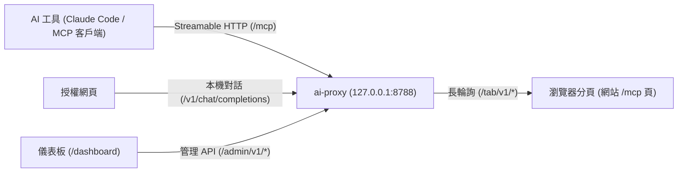

# MCP Pages 與 ai-proxy 文件

**MCP Pages** 是一份開放規範，讓任何靜態網站（例如 GitHub Pages）不需要後端伺服器，就能透過瀏覽器分頁將 [WebMCP](https://github.com/webmachinelearning/webmcp) 工具提供給讀者電腦上的 AI 工具。

**`ai-proxy`** 是跑在讀者本機（預設 `127.0.0.1:8788`）的零依賴參考轉送服務，負責將 AI 工具（如 Claude Code、Cursor 或標準 MCP 客戶端）的請求透過長輪詢轉送至網站的 `/mcp` 瀏覽器分頁。

## 架構總覽



## 快速開始

啟動本機轉送服務，並將本站的 MCP 頁面加入你的 AI 工具：

```bash
npx ai-proxy serve
npx ai-proxy add https://<host>/<org>/<repo>/mcp.html
```

或是允許並連接任何範例靜態網站：

```bash
npx ai-proxy allow https://example.github.io/my-docs/
npx ai-proxy add https://example.github.io/my-docs/mcp.html
```

## 核心規範文件

1. **[MCP Pages 規範 (`spec.md`)](doc.html?d=zh-TW/spec)** — 定義網站與轉送的職責：網址正規化、URL fragment 金鑰交接、WebMCP `ModelContext` 工具規格與分頁生命週期。
2. **[通訊協定 (`protocol.md`)](doc.html?d=zh-TW/protocol)** — 詳列 `/mcp`、`/tab/v1/*`、`/v1/*` 與 `/admin/v1/*` 的每一個 HTTP 請求、回應格式與錯誤碼。
3. **[安全模型 (`security.md`)](doc.html?d=zh-TW/security)** — 針對 `<user>.github.io` 共用 origin 的威脅模型，以及七條安全底線與各自攔截的攻擊手法。
