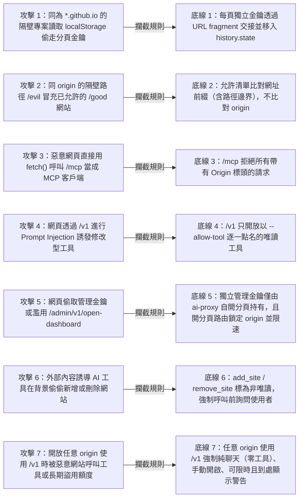

# 安全模型與威脅分析（Security Model）

**MCP Pages** 與 **`ai-proxy`** 的所有設計都建立在一個核心前提上：

> **`<user>.github.io` 上的所有網站共用同一個 `Origin`（`https://<user>.github.io`），因此必須假設同一個 origin 底下隔壁路徑的頁面都具有敵意。**

在一般網站架構中，瀏覽器的同源政策（Same-Origin Policy, SOP）能隔離不同網站。但在 GitHub Pages（`<user>.github.io/<repo>`）這類共用網域的靜態託管平台上，`https://example.github.io/trusted-docs/` 與隔壁的 `https://example.github.io/untrusted-demo/` 擁有**完全相同的 `Origin`**：
- 兩者發出的 HTTP 請求帶有相同的 `Origin: https://example.github.io` 標頭。
- 兩者共用同一個 `window.localStorage`、`IndexedDB` 與同源 Cookie。

以下七條安全底線皆為強制規範，並在程式碼與自動化測試中逐一驗證（拿掉任何一條保護，對應測試就會變紅失敗）。

---

## 威脅與防禦對照圖

---

## 七條安全底線與擋住的攻擊

### 底線 1：每個頁面網址一把金鑰，由 URL Fragment 交接並移入 `history.state`

- **安全規則**：每個正規化後的頁面網址都配有一把獨立金鑰。金鑰放在 URL fragment（`#mcp-key=…&mcp-port=…`）交給分頁；分頁讀到後立刻移進 `window.history.state`，並透過 `history.replaceState` 從網址列清掉，**絕不寫進 `localStorage`、`sessionStorage`、`IndexedDB` 或 `cookie`**。
- **擋住的攻擊**：
  1. **同 Origin 隔壁專案偷取 Storage 金鑰**：若某個專案分頁把金鑰存進 `localStorage`，同一個 `<user>.github.io` 底下任何其他 repo 的頁面都能直接讀取 `localStorage` 偷走金鑰並冒充該分頁。放在 `history.state` 中只屬於該分頁當下的瀏覽歷史項目，隔壁分頁或同源的其他頁面無法讀取。
  2. **Referer 標頭與網址列外洩**：URL fragment 不會隨 HTTP 請求或 `Referer` 送出，且載入後立刻從網址列清除，避免使用者截圖或複製網址時外洩金鑰。
  3. **跨頁金鑰重用**：因為每個頁面網址的金鑰各自獨立，單一頁面的金鑰無法用來通過其他頁面網址的 `/tab/v1/hello` 驗證。

---

### 底線 2：轉送只回應允許清單底下的頁面（比對網址前綴，localhost 一律允許）

- **安全規則**：`ai-proxy` 只回應允許清單底下的頁面，比對的是具備路徑邊界的**網址前綴**（`matchesPrefix`），而非 `Origin`；`localhost`、`127.0.0.1` 與 `[::1]` 一律允許。
- **擋住的攻擊**：
  1. **同 Origin 跨路徑冒充與前綴碰撞攻擊**：當使用者只允許 `https://example.github.io/my-docs` 時，同 origin 的 `https://example.github.io/other-repo` 或名稱相似的 `https://example.github.io/my-docs-evil` 都會被路徑邊界前綴比對擋下（回傳 `403 Forbidden`）。
  2. **未授權網站私自連線**：不在允許清單內的遠端網頁就算探測到本機 `ai-proxy` 埠號，也無法註冊分頁或被 AI 工具呼叫。

---

### 底線 3：`/mcp` 拒絕帶 `Origin` 的請求（網頁不能直接當 MCP 客戶端）

- **安全規則**：任何發往 `/mcp`（含 `/mcp?url=…` 與 `/mcp/<host>/<path>`）的 HTTP 請求，只要帶有 `Origin` 標頭，一律拒絕並回傳 `403 Forbidden`。
- **擋住的攻擊**：
  1. **惡意網頁直接呼叫本機 MCP 工具**：瀏覽器中的任何網頁透過 `fetch()` 或 `XMLHttpRequest` 呼叫 `http://127.0.0.1:8788/mcp` 時，瀏覽器都會強制加上無法偽造或移除的 `Origin` 標頭。拒絕所有帶 `Origin` 的請求，確保只有本機端程序（如 Claude Code、CLI）能擔任 MCP 客戶端，任何網頁都無法直接呼叫其他分頁上的 WebMCP 工具。

---

### 底線 4：只有唯讀工具會到達「網頁能下 prompt 的模型」（`/v1` 逐一點名限制）

- **安全規則**：`/v1`（提供給網頁呼叫的本機 chat completions）只開放以 `--allow-tool mcp__<server>__<tool>` **一個一個點名**允許、且工具本身標記為唯讀（`annotations.readOnlyHint === true`）的工具，不能整個 server 一起開，也不能開放非唯讀工具。
- **擋住的攻擊**：
  1. **網頁間接 Prompt Injection 觸發危險操作**：網頁的「問 AI」功能會將網頁內容或讀者輸入送進模型。若模型能呼叫非唯讀工具或整個 MCP server 的所有工具，攻擊者就能透過提示詞注入（Prompt Injection）誘導模型執行新增/刪除網站或修改資料。強制「逐一點名＋僅限唯讀工具」確保網頁發起的對話永遠只能讀取公開資訊、絕不會產生副作用。

---

### 底線 5：獨立管理金鑰與鎖定 Origin、限速的「打開儀表板」路由

- **安全規則**：
  1. 管理 API（`/admin/v1/*`）使用另一把獨立的管理金鑰（`admin-key`）。
  2. 只有登記過的儀表板頁拿得到管理金鑰，而且永遠只放在 `ai-proxy` 自己打開的分頁裡（透過 `#admin-key=…` 移入 `history.state`）。
  3. 唯一不用金鑰的管理路由是 `POST /admin/v1/open-dashboard`（「請 `ai-proxy` 打開儀表板」）：只接受儀表板自己的 `Origin`，開的是預先登記過的儀表板網址，**回應內絕不回傳金鑰**，並且嚴格限速（Rate Limit）。
- **擋住的攻擊**：
  1. **透過 API 回應竊取管理金鑰**：若 `open-dashboard` 在 HTTP 回應中直接回傳管理金鑰，同一個 `<user>.github.io` origin 下的任何惡意網頁都能發送 `fetch()` 拿到管理金鑰並接管整個 `ai-proxy`。改由 `ai-proxy` 親自開啟登記過的儀表板分頁並將金鑰放在該分頁的 fragment，呼叫端只會收到 `{"ok": true}`，完全拿不到金鑰。
  2. **任意網址跳轉洩漏金鑰（Open Redirect）**：因為開啟的網址固定為登記過的儀表板網址，攻擊者無法傳入釣魚網址騙 `ai-proxy` 把 `#admin-key` 送到外部頁面。
  3. **狂開分頁阻斷服務（Tab Bombing DoS）**：透過限速機制（超過頻率回傳 `429`），防止惡意腳本無限迴圈觸發瀏覽器彈出大量分頁。

---

### 底線 6：會改東西的 MCP 工具標成非唯讀，呼叫前必先問人

- **安全規則**：會修改設定或狀態的 MCP 工具（如本站 MCP 頁的 `add_site`、`remove_site`）必須標記為非唯讀（`annotations: { readOnlyHint: false, destructiveHint: true }`），且工具說明（`description`）中明確寫出「只在讀者明確要求新增或移除該網站時才呼叫」。
- **擋住的攻擊**：
  1. **AI 工具未經同意自動修改設定**：Claude Code 等 AI 工具對唯讀工具通常允許自動執行，但對 `readOnlyHint: false` 的工具會在每次呼叫前跳出詢問視窗請使用者確認。這確保沒有任何網站能透過連結或說明文字讓 AI 在背景偷偷新增或刪除網站。

---

### 底線 7：「任何 origin 都能用 `/v1`」只能是純聊天、手動開啟、可限時且到處顯示警告

- **安全規則**：「任何 origin 都能用 `/v1`」（`allow-origin *`）開啟時：
  1. **只能是純聊天（完全不掛載任何工具）**，即使啟動時有傳 `--allow-tool` 也不開放給 `*` 模式；
  2. 一定要由使用者手動打開（預設關閉），且支援設定有效時間（TTL 到期自動關閉）；
  3. 開著時在 CLI（`sites`、`doctor`、`serve`）與網頁（儀表板、MCP 頁）到處都顯示醒目警告。
- **擋住的攻擊**：
  1. **任意網站跨站濫用工具與無聲消耗額度**：當允許所有 origin 呼叫 `/v1` 時，使用者瀏覽的任何網站都能連上 `127.0.0.1:8788/v1`。強制零工具可防止外部網站藉機刺探本機 MCP 工具，而手動開啟、限時自動關閉與醒目警告則防止使用者忘記關閉而遭背景網站長期盜用模型額度。
