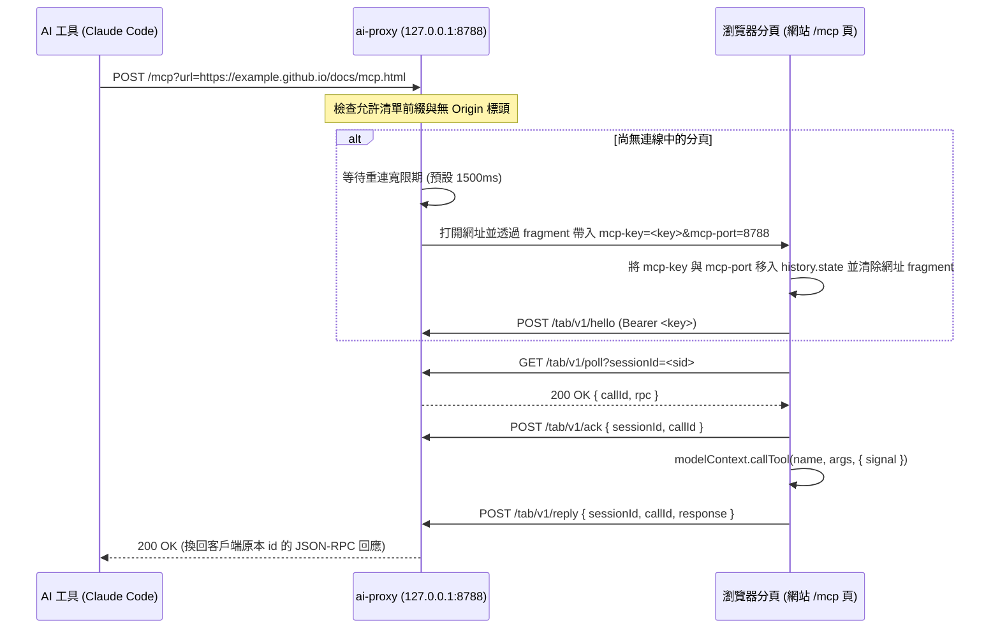

# MCP Pages 規範（Specification）

**MCP Pages** 定義任何靜態網站（例如 GitHub Pages）如何在瀏覽器分頁中註冊 [WebMCP](https://github.com/webmachinelearning/webmcp) 工具，並透過讀者本機的轉送服務（`ai-proxy`）提供給本機 AI 工具呼叫。

---

## 1. 角色與職責



### 網站端（分頁端）職責
1. **提供 MCP 頁面**（慣例為 `mcp.html` 或 `/mcp`），載入零依賴 ES modules（`web/*.mjs`）。
2. **安全交接金鑰**：從 URL fragment（`#mcp-key=…&mcp-port=…` 或 `#admin-key=…`）讀取金鑰後，立刻移入 `history.state` 並透過 `history.replaceState` 從網址列清除，絕不寫入 `localStorage`、`sessionStorage` 或 `cookie`。
3. **註冊 WebMCP 工具**：透過 `navigator.modelContext`（`ModelContext`）註冊工具、定義 `inputSchema` 與 `annotations.readOnlyHint`。
4. **維持長輪詢連線**：與 `http://127.0.0.1:<port>/tab/v1/*` 進行 `hello` / `poll` / `ack` / `reply` / `tools` 通訊；收到 `409 Conflict` 時自動重新 `hello`。
5. **提供參考 UI**：顯示連線狀態、工具目錄，並支援以 `?tool=<工具名稱>` 網址參數直接執行唯讀工具並顯示結果。

### 轉送端（`ai-proxy`）職責
1. **強制允許清單前綴比對**：只回應允許清單底下的頁面網址前綴（而非僅比對 origin）；`localhost` / `127.0.0.1` / `[::1]` 一律允許。
2. **每頁獨立金鑰**：每個正規化後的頁面網址配置一把獨立金鑰。
3. **提供 Streamable HTTP MCP 端點**：支援 `POST /mcp?url=<頁面網址>` 與 `POST /mcp/<host>/<path>`（只回傳 JSON），當多個客戶端同時連同一頁時，在轉送端改寫 JSON-RPC `id`，回覆時再換回客戶端原本的 `id`。
4. **管理分頁生命週期**：有呼叫進來時喚醒閒置分頁；轉送重啟後先等待重連寬限期讓既有分頁重新連上，再決定是否開新分頁；管理佇列上限與執行逾時。
5. **保護 `/v1` 與 `/admin/v1`**：強制檢查 Origin、限制 `/v1` 僅能使用以 `--allow-tool mcp__<server>__<tool>` 逐一點名的唯讀工具，以及使用獨立的管理金鑰保護管理路由。

---

## 2. 頁面網址正規化與允許清單前綴比對

由於 `<user>.github.io` 上的所有專案網站共用同一個 `Origin`（例如 `https://example.github.io`），**絕對不能以 origin 作為信任單位**。所有識別與授權皆以**正規化後的頁面網址**與**路徑邊界前綴**為準。

### 2.1 `normalizePageUrl(rawUrl)`
給定任意網址字串或 `URL` 物件：
1. 解析為絕對 `URL`，僅允許 `http:` 與 `https:` 協定（其餘協定拋出錯誤或回傳 `400`）。
2. 將協定與主機名稱轉為小寫，並移除預設埠號（`http:` 的 `:80`、`https:` 的 `:443`）。
3. 移除網址中的帳號密碼欄位（`username` / `password`）。
4. 移除查詢參數（`?search`）與片段（`#hash`）。
5. 正規化路徑（解析 `.` 與 `..`，合併重複斜線 `//` 為 `/`）。
6. 若路徑以 `/index.html` 結尾，正規化為以 `/` 結尾（但像 `/mcp.html` 這種明確的端點檔名則保留原樣）。

### 2.2 `matchesPrefix(targetUrl, allowedPrefix)`
1. 先將 `targetUrl` 與 `allowedPrefix` 都透過 `normalizePageUrl` 正規化。
2. 兩者的 `origin`（協定 + 主機 + 埠號）必須完全相同。
3. 路徑邊界規則：
   - 若 `allowedPrefix` 的路徑為 `/`，則同 origin 下的任何路徑皆符合。
   - 若 `allowedPrefix` 的路徑以 `/` 結尾（例如 `/repo/`），則 `targetUrl` 的路徑必須等於 `/repo` 或以 `/repo/` 開頭。
   - 若 `allowedPrefix` 的路徑不以 `/` 結尾（例如 `/repo` 或 `/repo/mcp.html`），則 `targetUrl` 的路徑必須完全等於該路徑，或以 `allowedPrefix路徑 + "/"` 開頭。
   - **關鍵邊界保護**：允許 `https://example.github.io/app` 時，**絕對不可**匹配隔壁的 `https://example.github.io/app-evil` 或 `https://example.github.io/app2/mcp.html`。

### 2.3 `isLocalhostUrl(rawUrl)`
當且僅當網址為 `http:` 或 `https:`，且主機名稱為下列之一時回傳 `true`：
- `localhost`
- `127.0.0.1`
- `[::1]` 或 `::1`

本機開發網址（localhost）一律通過允許清單檢查。

---

## 3. URL Fragment 金鑰交接

當 `ai-proxy` 為某個頁面打開瀏覽器分頁時，會將該頁專屬金鑰與連接埠放在 URL fragment：

```
https://example.github.io/project/mcp.html#mcp-key=<per_page_key>&mcp-port=8788
```

當 `ai-proxy` 打開登記過的儀表板分頁時，則傳遞管理金鑰：

```
http://127.0.0.1:8788/dashboard/#admin-key=<admin_key>&mcp-port=8788
```

### 分頁讀取與清除流程（`extractHandshake(win)`）
1. 分頁載入時立刻解析 `win.location.hash` 中的 `mcp-key`、`mcp-port` 與 `admin-key`。
2. 將讀到的值合併寫入 `win.history.state.__aiProxy`（保留 `history.state` 原有的其他欄位）。
3. 立刻呼叫 `win.history.replaceState(mergedState, '', cleanUrl)`，把 `#mcp-key=…` 等敏感資訊從網址列與歷史紀錄清掉。
4. 若重新整理頁面時 `location.hash` 為空，直接從 `win.history.state.__aiProxy` 取回金鑰與埠號。
5. **嚴禁寫入 Storage**：分頁絕不將 `mcpKey` 或 `adminKey` 寫入 `localStorage`、`sessionStorage`、`IndexedDB` 或 `cookie`，防止同一個 `<user>.github.io` 下的其他惡意專案讀取。

---

## 4. WebMCP `ModelContext` 與工具規格

分頁端實作 WebMCP `navigator.modelContext`（`ModelContext`），讓靜態頁面用標準介面註冊工具。

### 4.1 工具定義格式
```js
navigator.modelContext.registerTool({
  name: "search_docs",
  description: "以關鍵字搜尋文件段落。",
  inputSchema: {
    type: "object",
    properties: {
      query: { type: "string", description: "搜尋關鍵字" },
      limit: { type: "integer", description: "回傳筆數上限 (1-20)" }
    },
    required: ["query"],
    additionalProperties: false
  },
  annotations: {
    title: "搜尋文件",
    readOnlyHint: true,
    destructiveHint: false,
    idempotentHint: true,
    openWorldHint: false
  },
  async execute(input, { signal }) {
    signal?.throwIfAborted?.();
    return { matches: [] };
  }
});
```

### 4.2 工具定義與參數檢查規則
1. **`name`**：必填非空字串，格式須符合 `/^[a-zA-Z0-9_-]{1,64}$/`。
2. **`description`**：必填非空字串，清楚說明工具用途與使用時機。
3. **`inputSchema`**：JSON Schema 物件，根節點必須是 `type: "object"`（省略時預設為 `{ type: "object", properties: {} }`）。
4. **`annotations`**：選填物件。`readOnlyHint` 未明確設為 `true` 時一律視為 `false`（非唯讀）。會修改狀態的工具（如 `add_site`、`remove_site`）必須標記 `readOnlyHint: false`。
5. **`execute(input, { signal })`**：必填執行函式。呼叫前會先依據 `inputSchema` 驗證必填欄位（`required`）、型別（`string`、`number`、`integer`、`boolean`、`array`、`object`）、`enum` 與 `additionalProperties: false`。驗證失敗回傳 JSON-RPC `-32602 Invalid params`。
6. **取消機制（`AbortSignal`）**：當客戶端送出 `notifications/cancelled` 或連線中斷時，觸發 `signal` abort；若執行前或執行中收到 abort，立刻拒絕並回報取消錯誤（`-32800`）。

---

## 5. 分頁生命週期與轉送協調

1. **閒置與喚醒**：
   - 分頁平時維持一個 `GET /tab/v1/poll?sessionId=<sid>` 長輪詢連線。
   - 若在 `pollTimeoutMs`（預設 `25000ms`）內沒有呼叫，轉送回傳 `204 No Content`，分頁可進入低耗能閒置或立即發起下一次 `poll`。
   - 一旦 AI 工具對 `/mcp` 發出呼叫，轉送立刻將長輪詢回應喚醒並回傳 `200 OK { callId, rpc }`。
2. **轉送重啟與重連寬限期**：
   - 當 `ai-proxy` 重啟後，原本開著的分頁帶著舊 `sessionId` 來 `poll`、`ack`、`reply` 或 `tools` 時會收到 `409 Conflict`。
   - 分頁收到 `409` 時，立刻用 `history.state` 裡的金鑰重新呼叫 `POST /tab/v1/hello` 取得新 `sessionId`，無須重新開新分頁。
   - 轉送啟動後若收到針對某頁面的 MCP 請求且當下無連線分頁，會先等待一段**重連寬限期**（預設 `1500ms`）讓既有分頁重新連上，逾時仍無分頁連上才呼叫瀏覽器開啟新分頁。
3. **確認（Ack）與回覆（Reply）**：
   - 分頁收到 `{ callId, rpc }` 後先送出 `POST /tab/v1/ack`，再執行工具並將結果透過 `POST /tab/v1/reply` 送回轉送。

---

## 6. 參考 MCP 頁 UI 與 `?tool=` 直接檢視

`web/ui.mjs` 為每個 MCP 頁提供一致的視覺介面：
- **狀態列**：顯示 `ai-proxy` 是否在執行（未帶金鑰時透過 `no-cors` 探測）、是否已取得頁面金鑰、目前連線狀態與 `sessionId`。
- **工具目錄**：列出所有註冊工具、唯讀/非唯讀標籤（`Read-Only` / `Mutating`）、參數 Schema 與互動測試表單。
- **`?tool=` 直接看結果**：當網址帶有 `?tool=<工具名稱>`（以及對應參數或 `&input=<JSON>`）時，若該工具為唯讀（`annotations.readOnlyHint === true`），頁面載入後會自動執行該工具並直接渲染結果；非唯讀工具絕不自動執行。
